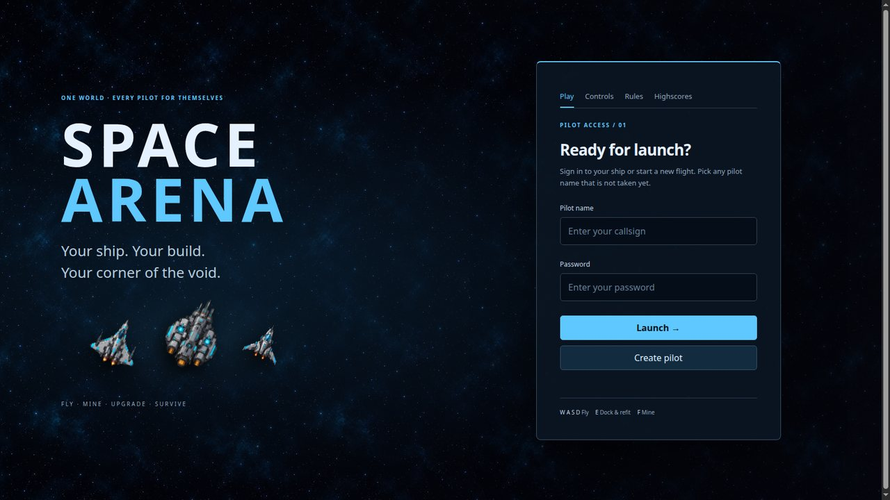
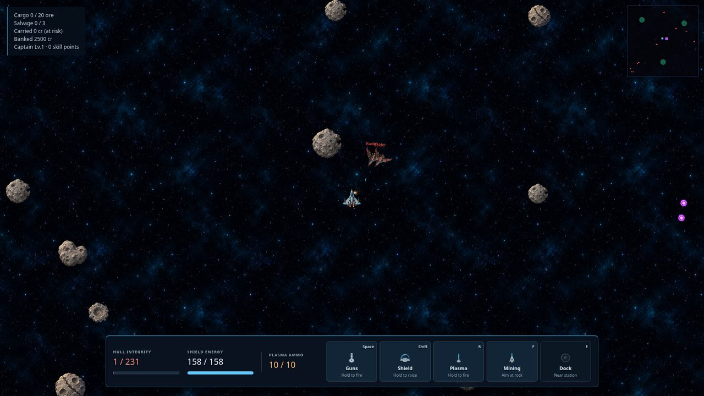
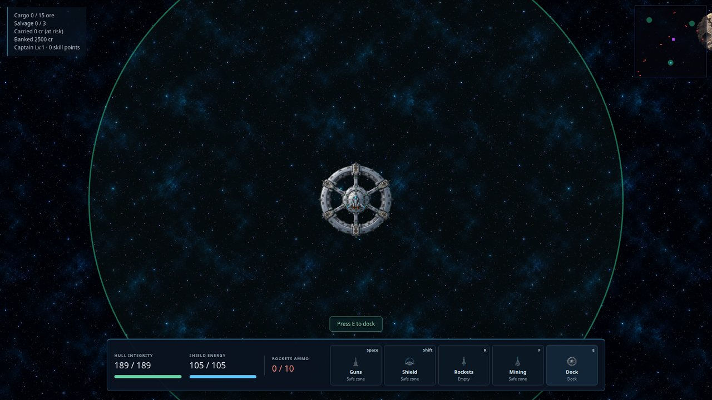
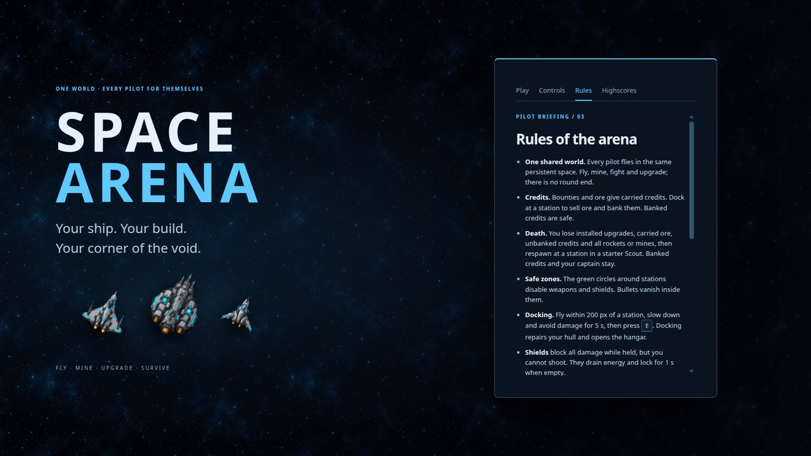
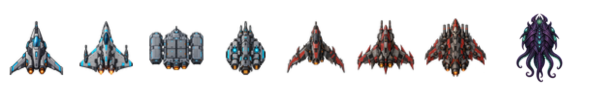

<div align="center">

# 🚀 Space Arena

**A 2D multiplayer space shooter in the browser — one shared, persistent world, every pilot for themselves.**

Fly with inertia, mine asteroids, fight other pilots and pirate patrols, refit your ship at stations, train your captain and hunt the Void Leviathan in the heart of the map.

[**▶ Play now — spacearena.duckdns.org**](https://spacearena.duckdns.org)




</div>

---

## ✨ Features

| | |
|---|---|
| 🌌 **One persistent world** | Everyone flies in the same 20 000 × 20 000 arena. Your ship, credits and captain are saved. |
| 🕹️ **Inertial flight** | Real momentum with a little grip while thrusting — drift, turn and strafe. |
| ⚔️ **PvP combat** | Lasers and cannons, shields that block everything (but stop you shooting), PvP bounties and a kill leaderboard. |
| 🎯 **Three kinds of ammunition** | Homing **rockets**, proximity **space mines**, or the **plasma blaster** that knocks out the target's shield for 5 s. |
| 🏴‍☠️ **Pirate patrols** | Raiders, Marauders and Warlords get tougher the farther you fly from the stations and drop loot crates. |
| 🐙 **Void Leviathan** | A huge alien world boss drifts around the center, fires slow plasma orbs and drops 1 500 cr plus a Mk3 item. Respawns every 10 minutes. |
| ⛏️ **Mining & economy** | Drill asteroids, haul ore, dock to sell and bank your credits — carried credits are lost on death. |
| 🛠️ **Builds** | Four hulls and Mk1–Mk3 gear for weapon, shield, engine and utility slots, plus salvage from crates. |
| 🎖️ **Captains** | Earn XP, level up and train gunnery, engineering, piloting and mining — permanent across deaths. |
| 📱 **Desktop & mobile** | Keyboard controls or a touch flight stick with landscape fullscreen. |

## 📸 Screenshots

<table>
  <tr>
    <td></td>
    <td></td>
  </tr>
  <tr>
    <td align="center"><sub>Raiders closing in while the Leviathan's plasma orbs fly past</sub></td>
    <td align="center"><sub>Safe zone around a station — dock to sell ore and refit</sub></td>
  </tr>
</table>

<div align="center">
  
  <br /><sub>Controls, rules and the PvP highscores are on the main page</sub>
</div>

## 🛸 The fleet

<div align="center">
  
  <br /><sub>Scout · Fighter · Freighter · Gunship &nbsp;|&nbsp; Raider · Marauder · Warlord &nbsp;|&nbsp; Void Leviathan</sub>
</div>

## 🎮 How to play

| Key | Action |
|---|---|
| `W` / `S` | Thrust / reverse and brake |
| `A` / `D` | Rotate |
| `Space` | Fire guns |
| `Shift` | Raise shield |
| `R` | Fire rockets, drop mines or fire plasma — whatever you carry |
| `F` | Mining laser |
| `E` | Dock / undock at a station |

On a phone, drag the left stick to fly and use the buttons on the right. The full manual is in [`controls.md`](controls.md).

## 🏗️ How it works

```
┌─────────────── browser ───────────────┐        ┌──────────────── server (Node) ────────────────┐
│ PixiJS renderer · HUD · hangar menu   │  WS    │ Gateway ── zod-validated messages             │
│ input → client-side prediction        │◀──────▶│ World (30 Hz) ── Combat · Rockets · Mines ·   │
│ interpolation of other entities       │ 20 Hz  │   Plasma · Mining · Loot · Docking · Shop     │
└───────────────────────────────────────┘ snaps  │   PirateDirector · BossDirector               │
                 ▲                               │ SQLite persistence (versioned migrations)     │
                 └──── shared: physics, stats, protocol, catalogs ────────────────────────────────┘
```

- **Server-authoritative.** Clients only send inputs and shop/dock requests; every message is validated with zod.
- **Shared rules.** Physics (`stepMotion`) and ship stats (`statsFor`) live in `packages/shared` and run identically on server and client, so the client can predict its own ship.
- **Small pure modules.** Game rules are focused modules; `World` only sequences them each tick.
- **Art is optional.** Sprites are listed in `assets/manifest.json`; anything missing renders as a placeholder.

| Package | Contents |
|---|---|
| `packages/shared` | Protocol, constants, deterministic physics, hull/gear/pirate/boss catalogs, build stats |
| `packages/server` | HTTP auth, WebSocket gateway, world simulation, NPC directors, SQLite |
| `packages/client` | Vite + PixiJS 8 client: input, prediction, interpolation, renderer, HUD, menus |
| `assets` | Sprites, `manifest.json` and the art direction in `STYLE.md` |

## 🧑‍💻 Run it locally

Requires **Node ≥ 22** and **pnpm 9**.

```bash
pnpm install --frozen-lockfile
pnpm build          # build the client into packages/client/dist
pnpm start          # server + client on http://localhost:8080 (DB: arena.db)
```

For development, run `pnpm dev:server` and `pnpm dev:client` (Vite proxies `/api` and `/ws` to `:8080`).

```bash
pnpm typecheck && pnpm test && pnpm lint   # run before every commit
pnpm assets:check                          # every sprite in the manifest exists with the right size
```

## 🚢 Deployment

`.github/workflows/deploy.yml` runs checks on every push to `master`, builds a Docker image to GHCR and deploys it over a restricted SSH command to a server running nginx + Docker (see [`deploy/`](deploy)). The deploy rolls back automatically if the health check fails.

## 🤝 Contributing

Read [`AGENTS.md`](AGENTS.md) for the architecture rules, code style and testing conventions, and the design specs in [`docs/superpowers/specs`](docs/superpowers/specs). Game rules are written test-first.

The sprites were generated with AI (OpenAI Codex) following [`assets/STYLE.md`](assets/STYLE.md).

## 📄 License

[MIT](LICENSE) © 2026 zakyn47
